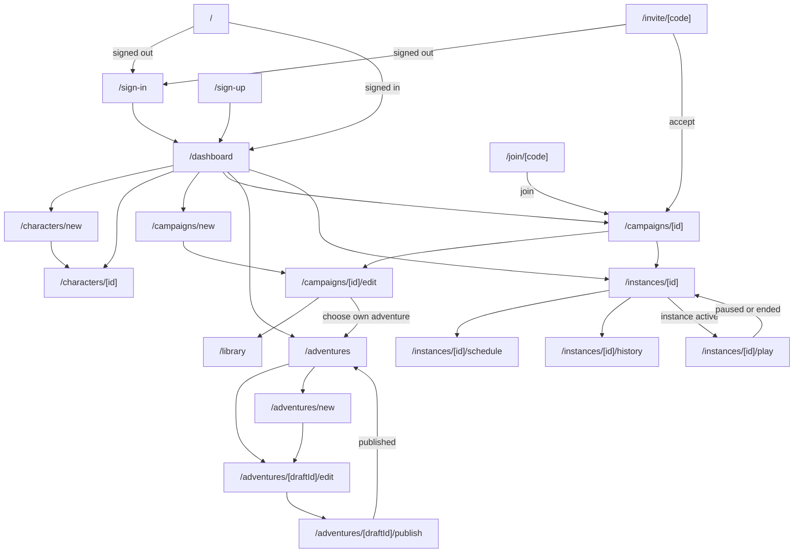

# Application Flow

## Scope

Cadmium is a virtual tabletop, not a social platform. People play with people they already know outside the game.

| Present | Absent by design |
|---|---|
| Campaign invitations by single-use code and by invite link | User search, directories, and profiles |
| Campaign members and their characters | Friends, following, and followers |
| Play inside a campaign's instances | Messaging outside games |
| The user's own adventures in their own campaigns | Public or shared adventure listings |

Content is therefore visible only to the people its author invited. Moderation is limited to responding to reports sent to the contact address, as stated in the Terms of Service.

This document maps the web application's pages, navigation, and server boundaries for the reference deployment. It binds the platform-agnostic design ([architecture.md](architecture.md), [api.md](api.md)) to a specific stack.

## Stack

| Concern | Technology | Role |
|---|---|---|
| Web framework | Next.js (App Router) | Pages, server components, route handlers, server actions |
| Styling | Tailwind CSS | All UI styling |
| Hosting | Vercel | Serverless functions, cron jobs, static assets |
| Authentication | Clerk | Sign-in, sign-up, sessions, user profile |
| Database | Supabase Postgres | All records in [data-model.md](data-model.md) |
| Real-time | Supabase Realtime | Instance and user message streams |
| Models | Groq | Parser and narrator adapters |
| Push | Web Push with the deployment's own VAPID key pair, through the `web-push` package; a service worker in the client | Session reminders on browsers where the user enables them |
| Adventure editor | React Flow (`@xyflow/react`), Ajv (`Ajv2020`), `yaml`, Monaco with `monaco-yaml` | Arc graphs, in-browser validation, YAML import and export, advanced YAML view |
| Maps | HTML canvas, drawn by `lib/map` from views and drafts | The map editor and the play map |
| Fonts | Libertinus Serif, Serif Display, Sans, Mono (SIL OFL), self-hosted | All text; see [design/foundations.md](design/foundations.md#typography) |
| Icons | Lucide through `lucide-react` (ISC); game-icons.net SVGs (CC BY 3.0) | Interface actions; adventure content |
| Theme | `design/theme.css` | Tailwind tokens for colour, type, space, and sizes |

### Stack constraints

| Constraint | Consequence |
|---|---|
| Vercel functions cannot hold WebSocket connections. | The `subscribe` and `subscribe_me` streams are Supabase Realtime channels. Clients reconnect and backfill missed commits with `get_history(after_version)`. |
| Vercel functions have a maximum duration. | Input processing commits before narrating. Narration runs in `after()`, so the response returns once the commit succeeds. |
| Serverless functions keep no timers between requests. | Round deadlines are stored in state. The scheduler cron job and any request to the instance call `advance` when a deadline has passed. |
| No analytics, tracking pixels, or marketing cookies. | Vercel Web Analytics and similar tools are not enabled. Only Clerk's session cookies, browser storage for theme and editor backups, and the push service worker are used, as stated in the Privacy Policy. |
| Cadmium sends no email. | Invitations are codes the inviter shares. Reminders use the user channel and Web Push. Clerk sends its own sign-in emails. |
| iOS delivers Web Push only to sites added to the Home Screen. | Settings explains Add to Home Screen on iOS before offering browser notifications there. |
| Groq runs with zero data retention. | Enable Zero Data Retention in the Groq console Data Controls before launch; the Privacy Policy states it. |
| Fonts and icons load from the application's own domain. | No third-party font or icon CDN is used; font files are subset WOFF2 under `/fonts/`, and icons are bundled per import. |
| Clerk owns identities; Supabase owns records. | A Clerk webhook creates and updates the User row. Records reference the Clerk user id. |
| Rules data lives in the specification repository. | The engine and the Quest system are implemented in TypeScript in `lib/engine` and `lib/systems/quest`; Quest loads `systems/quest/data.json` and its schemas at build time. |

## Route map

Every route except those marked public requires a signed-in user. Clerk middleware redirects signed-out users to `/sign-in?redirect_url=<original path>`.

| Route | Page | Access | Shows | Operations |
|---|---|---|---|---|
| `/` | Entry | public | Redirects to `/dashboard` when signed in, otherwise to `/sign-in` | none |
| `/sign-in/[[...rest]]` | Sign in | public | Clerk `<SignIn />` | Clerk |
| `/sign-up/[[...rest]]` | Sign up | public | Clerk `<SignUp />` | Clerk |
| `/invite/[code]` | Invitation | public | Campaign title, inviter, message; Accept and Decline after sign-in | `preview_invitation`, `accept_invitation`, `decline_invitation` |
| `/join/[code]` | Join by link | public | Campaign title and author; Join | `join_by_link` |
| `/dashboard` | Dashboard | user | Upcoming sessions, active instances, campaigns, characters | `get_me`, `list_occurrences`, `list_campaigns`, `list_characters` |
| `/characters/new` | Character creation | user | System picker, then the system's creation form | `list_systems`, `get_system_schema`, `create_character` |
| `/characters/[id]` | Character editor | owner | Sheet (read-only), name, profile, status, instance | `get_character`, `update_character`, `upload_asset`, `retire_character` |
| `/campaigns/new` | Campaign creation | user | Title; system, defaulting to Cadmium, with its credit line; module checkboxes, preselected from the materials' required modules; materials | `list_systems`, `list_materials`, `create_campaign` |
| `/campaigns/[id]` | Campaign overview | members | Description, members, instances, materials | `get_campaign`, `list_instances` |
| `/campaigns/[id]/edit` | Campaign editor | author | Tabs: Details, Materials, Members, Invitations | `update_campaign`, `set_materials`, `invite`, `list_invitations`, `revoke_invitation`, `rotate_invite_link`, `disable_invite_link`, `remove_member`, `archive_campaign` |
| `/library` | Library | user | Settings and example adventures installed with Cadmium, and the user's own published adventures, filtered by system | `list_materials` |
| `/adventures` | My adventures | user | The user's drafts and published versions | `list_drafts`, `list_materials(owner=me)` |
| `/adventures/new` | Adventure creation | user | Id, title, system, required settings, or import from ZIP | `create_draft`, `import_draft` |
| `/adventures/[draftId]/edit` | Adventure editor | draft owner | See [Adventure editor](#adventure-editor) | `get_draft`, `save_draft`, `validate_draft`, `export_draft` |
| `/adventures/[draftId]/publish` | Publish | draft owner | Version, diagnostics summary, changes since the last version | `validate_draft`, `publish_draft` |
| `/instances/[id]` | Instance lobby | members | Status, characters, next session, Start/Resume/Pause/End | `get_instance`, `add_character`, `remove_character`, `start_instance`, `pause_instance`, `resume_instance`, `end_instance` |
| `/instances/[id]/schedule` | Schedule | members | Occurrences, RSVPs, calendar export and subscription; editing for the author | `list_occurrences`, `rsvp`, `schedule_session`, `update_session`, `move_occurrence`, `cancel_session`, `export_calendar`, `get_calendar_feed`, `rotate_calendar_feed` |
| `/instances/[id]/history` | History | members | Commits with narration, paged | `get_history` |
| `/instances/[id]/play` | Play | members with a character in the instance | Running interface; see [Play interface](#play-interface) | `get_instance`, `submit_input`, `submit_action`, `advance_round`, instance stream |
| `/notifications` | Notifications | user | Session reminders | user stream |
| `/settings` | Settings | user | See [Settings](#settings) | `update_me`, `get_push_key`, `add_push_subscription`, `list_push_subscriptions`, `remove_push_subscription`, `get_calendar_feed`, `rotate_calendar_feed`, `disable_calendar_feed`, `export_my_data`, `request_account_deletion` |
| `/terms` | Terms of Service | public | [legal/terms.md](legal/terms.md) | none |
| `/privacy` | Privacy Policy | public | [legal/privacy.md](legal/privacy.md) | none |
| `/attribution` | Attribution | public | Licences and attributions from [LICENSES.md](../LICENSES.md): rules data, including Quest as the source of Cadmium; Libertinus; Lucide; each game-icons.net artist whose icons ship; and the `credit` of every shipped pack asset | none |
| `/admin` | Operator console | operator | Materials, instance inspection | `publish_bundle`, `set_listed`, `inspect_instance`, `replay_instance`, `restore_instance` |

Links to `/terms`, `/privacy`, and `/attribution` appear in the footer of every page. Clerk's sign-up form requires accepting the Terms of Service and Privacy Policy (Clerk's legal-compliance setting); the acceptance is recorded with `accept_terms`. When either document changes, users accept the new version on their next sign-in.

## Navigation



### Redirect rules

| Condition | Result |
|---|---|
| Signed-out user opens a protected route | `/sign-in?redirect_url=<route>`; after sign-in or sign-up, Clerk returns to the route |
| User opens `/instances/[id]/play` while the instance is `lobby`, `paused`, or `ended` | `/instances/[id]` |
| User without a character in the instance opens `/play` | `/instances/[id]`, with the character picker open |
| Non-member opens a campaign or instance route | 404 page (matches `not_found` in [api.md](api.md#error-codes)) |
| Non-owner opens a draft route | 404 page |
| Draft owner leaves the editor with unsaved changes | Browser confirmation; the local backup restores them on return |
| Non-operator opens `/admin` | 404 page |
| Invitation code is expired, revoked, or used | `/invite/[code]` shows the reason and a link to `/dashboard` |

## Pages

### Dashboard

Visual treatment: [design/screens.md](design/screens.md#dashboard). Sections, in order:

1. **Upcoming sessions** — the next 7 days across all instances, with RSVP buttons, in the user's time zone.
2. **Active instances** — name, campaign, status, the user's character, next session; **Play** when `active`, **Open lobby** otherwise.
3. **Campaigns** — two lists: authored and joined. **New campaign** button.
4. **Characters** — name, system, status, current instance. **New character** button.
5. **Adventures** — the user's drafts with problem counts and last-saved time, and published versions. **New adventure** button.

Empty states link to the next action: a user with no characters sees **Create a character**; a user with no campaigns sees **Create a campaign** and a field that accepts an invitation code or invite link code.

### Character creation and editor

Creation is a two-step form:

1. Choose a system from `list_systems`.
2. Fill the system's creation form. The form fields come from the system: for Quest, a role picker, an ability picker limited to `starting_abilities`, and profile questions.

The server calls `create_character`; the rules system rolls and builds the sheet. Clients never submit sheet values.

The editor shows the sheet read-only, formatted by the system's `summary` and a system-specific sheet view. Editable fields: name, profile, and portrait. **Upload portrait** takes an image and its alt text, with optional licence, credit, and provenance fields for images made by someone else or with a generative tool. **Remove portrait** deletes it. **Retire** is available when the character is `available` or `dead`.

Each system provides three UI components, registered by system id: `CreationForm`, `SheetView`, and `StatsEditor` (the adventure editor's form for creature, item, and ability `system_stats`, generated from the system's schemas by default). Adding a system adds these components; no page changes. A system with modules shows module fields only when the campaign, or for character creation the chosen campaign, enables the module; Cadmium's components extend Quest's.

### Campaign editor

Tabs:

| Tab | Contents |
|---|---|
| Details | Title, description, system (fixed after creation), system version range |
| Materials | One adventure and its required settings, chosen from the library: installed materials and the author's own adventures, filtered to the campaign's system; incompatible materials are disabled with the reason |
| Members | Members and roles; **Remove** for players |
| Invitations | **Create invitation** with a message and a private note; the new code and link with **Copy**, shown once; pending invitations with notes and **Revoke**; invite link with **Copy**, **Rotate**, and **Disable** |

**Archive campaign** sits at the bottom of Details.

Adventure content is authored in the [adventure editor](#adventure-editor). Setting packs are authored as files and published through the operator console.

### Instance lobby

| Area | Contents |
|---|---|
| Header | Instance name, campaign link, status badge, pinned system version |
| Party | Characters in the instance with owners; **Add my character** opens a picker of the user's `available` characters for the campaign's system |
| Next session | Date, time, RSVP buttons, link to the schedule |
| Controls (author) | **Start**, **Resume**, **Pause**, **End**, each shown only when allowed by status |
| Play | **Enter game** when the instance is `active` and the user has a character in it |

**Create instance** lives on the campaign overview, author only.

### Schedule

- List of occurrences for the next 92 days, grouped by week, in the user's time zone.
- Each occurrence shows time, duration, status (`scheduled`, `moved`, `cancelled`), and RSVPs by member.
- Members set their RSVP per occurrence.
- The author creates and edits sessions (start, time zone, duration, weekly recurrence, `auto_resume`, `auto_pause`), moves or cancels one occurrence, or cancels the series.
- **Add to calendar** downloads `export_calendar`. **Subscribe** shows the user's calendar feed URL from `get_calendar_feed`; when the feed is disabled, it offers **Create feed**, which calls `rotate_calendar_feed`.

### Settings

| Section | Contents |
|---|---|
| Account | Clerk `<UserProfile />`: email address, password, sign-in methods, sessions. Display name, time zone. |
| Appearance | Theme: System, Light, Dark |
| Reminders | Lead times (default 24 hours and 15 minutes); **Browser notifications** on this browser; the list of browsers with notifications, each with **Remove** |
| Calendar | Feed URL with **Copy**, **New URL**, and **Turn off** |
| Your data | **Export my data** downloads `export_my_data`. **Delete account** asks for the display name, then states that the account can be restored by signing in for 30 days and is erased after 90 |

Every field a user entered elsewhere is edited where it was entered: characters, drafts, campaigns, sessions, and RSVPs.

### History

Commits in ascending version order with narration text, grouped by round. Event details expand per commit. The page pages with `after_version`. Ended instances open here from the dashboard.

## Adventure editor

The adventure editor lets authors without programming experience write adventure packs ([adventure-packs.md](adventure-packs.md)) against published setting packs for one rules system. It edits a draft: a single JSON document that maps one-to-one onto the adventure's YAML files. The editor never writes files; export and publish produce them.

### Draft document

```json
{
  "adventure": { "id": "sunken_archive", "title": "The Sunken Archive", "system": { "id": "quest", "versions": "^1.0" },
                 "requires_settings": [ { "id": "derelict_station", "versions": "^3.0" } ],
                 "players": [1, 4], "start": { }, "endings": { } },
  "flags": { },
  "arcs": { "find_the_core": { } },
  "locations": { "dock": { }, "lower_archive": { } },
  "npcs": { "archivist": { } },
  "entities": { "reactor_core": { } },
  "editor": { "layout": { }, "snapshots": [ ] }
}
```

The document's schema is `spec/schema/draft.schema.json`. Records are maps keyed by id. `editor` holds arc graph node positions and named snapshots; export and publish omit it.

### Layout

```
┌──────────┬──────────────────────────────────────────────┬────────────────┐
│ Sections │ Workspace                                     │ Inspector      │
│ Overview │  form, map, graph, or rule cards for the      │  fields of the │
│ Flags    │  selected section                             │  selected node │
│ Plot     │                                               │  or card       │
│ Locations│                                               │                │
│ NPCs     │                                               │                │
│ Items &  │                                               │                │
│ creatures│                                               │                │
├──────────┴──────────────────────────────────────────────┴────────────────┤
│ Problems (n)   ·   Saved 12:41   ·   Undo  Redo   ·   Playtest   Publish  │
└───────────────────────────────────────────────────────────────────────────┘
```

### Sections

| Section | Editing mode | Contents |
|---|---|---|
| Overview | Form | Title, system (fixed after creation), required settings with version ranges, player range, start location and room, endings as cards |
| Flags | Table | Name, type (`bool`, `int`, `enum`), range or values, initial value, and a "used by" count; deleting a flag in use is blocked with the list of uses |
| Plot | Graph and rule cards | One graph per arc: stages as nodes, `set_stage` effects as edges. Selecting a stage lists the triggers that act in or leave it as rule cards |
| Locations | Map editor or form | Authored locations: a map canvas with a palette of the built-in terrain, the settings' terrain, and legend entries; **Paint**, **Fill**, and **Rectangle** tools; **Room** draws a room's area and names it; **Place** puts a template, NPC, or door on a cell, and the inspector edits its id, lock, and hidden flag; **Link** places a link and picks its destination, with **Add return link**. Generated locations: generator form, anchors, links, and a seeded map preview |
| NPCs | Form | Name, template picker, disposition, topics as cards with a condition builder and brief text, secrets |
| Items & creatures | Form | Adventure-specific entities; `system_stats` edited with the system's `StatsEditor` |

Every section also offers **Edit as YAML**, which opens the matching file in Monaco with schema completion. Saving the YAML parses it back into the draft; a parse or schema error keeps the YAML open with the error marked.

### Rule cards

Each trigger is one rule insert, specified visually in [design/components.md](design/components.md#rule-inserts). Its parts:

```
WHEN   a player [talks to ▾ Archivist] about [the power core ▾]
IF     [all of ▾]  [arc Find the Core ▾] is at [inactive ▾]
THEN   1. set arc [Find the Core ▾] to [searching ▾]
       2. set flag [met_archivist ▾] to [true]
NARRATE "The archivist points toward the lift."
[✓] Only once
```

- **When** offers one sentence template per event type: talks to, interacts with, picks up, enters, defeats.
- **If** is a condition builder with *all of*, *any of*, and *none of* groups, nested at most two levels. Deeper expressions are edited in YAML.
- **Then** is an ordered list of effects, each with its own fields, reorderable by drag.
- Every bracket is a picker over ids from the draft and the required settings, showing labels. Typed ids are never required.
- Each card shows a plain-English summary below it.

### Pickers and references

The editor builds a reference index from the draft and the compiled bundles of the required settings: rooms, doors, links, NPCs and topics, items, creatures, obstacles, flags, arcs and stages, endings, conditions. Pickers list entries of the expected kind. Renaming a record's label changes no references; changing an id rewrites every reference in the draft.

### Validation

Validation runs in a Web Worker on every change, debounced, in three layers:

| Layer | Checks | Implementation |
|---|---|---|
| Schema | Shapes, types, enums, required fields, unknown keys | Ajv (`Ajv2020`) with the adventure schemas and the system's schemas for `system_stats` and checks |
| References | Every id resolves to a record of the expected kind | The reference index |
| Semantics | Map checks, room coverage, link pairing, ending reachability, lock satisfiability, anchor feasibility, unused flags, overlapping triggers | The shared Content Compiler in `lib/materials` |

Each diagnostic has `{ pointer, severity, code, message }`. The field at `pointer` shows the message inline; the Problems panel lists all diagnostics and jumps to each. The server runs the same compiler for `validate_draft` and `publish_draft`, so the editor and publication agree.

### Saving

- Changes save to the server with `save_draft` 2 seconds after the last edit, carrying the draft `revision`. A stale revision returns `conflict`; the editor offers to reload or to keep a copy as a new draft.
- A local backup in IndexedDB holds unsaved changes across reloads.
- Undo and redo cover every edit since the editor opened.
- **Snapshot** stores a named copy of the draft in `editor.snapshots`; any snapshot can be restored.
- **Export** downloads the adventure directory as a ZIP of YAML files. **Import** on `/adventures/new` reads such a ZIP.

### Playtest

**Playtest** opens a simulator panel that runs the TypeScript engine and rules system in the browser against the draft and the required settings:

- An event palette fires actions as a chosen character: move to a clicked cell or destination, talk with topic, interact, take, attack.
- A state inspector shows flags, arc stages, inventory, and the map with every entity, including hidden ones, and each door's state.
- A trace lists, for every action, the triggers that matched, the conditions that failed, and the effects applied.
- **Start from here** begins the simulation from a chosen arc stage and flag values.
- A party selector simulates up to the adventure's maximum player count.
- For generated locations, **Preview 20 seeds** draws each generated map and reports anchor and lock failures per seed.

The simulator uses no models; narration shows template text.

### Publishing

`/adventures/[draftId]/publish` takes a version. A published adventure is usable only in campaigns its author creates; players reach it by invitation.

Publishing fails while any diagnostic has severity `error`. The version must be greater than every published version of the draft's id; the page suggests the increment from [content-publishing.md](runbooks/content-publishing.md#versioning) based on the changes. Published versions are immutable; the draft remains editable for the next version.

## Play interface

### Layout

```
┌──────────────┬──────────────────────────────────────────┬────────────────┐
│ Character    │ Narrative log (the page)                  │ Margin         │
│  health, AP  │  player actions under player names        │  this round:   │
│  inventory   │  narration paragraphs                     │  who acted,    │
│  abilities   │                                           │  who is typing,│
│ Map          │                                           │  time left     │
│  seen cells, │                                           │                │
│  tokens      ├──────────────────────────────────────────┤  trace notes   │
│ Party        │ Choice: labelled option buttons            │  (playtest and │
│  names       │ Shortcuts and suggestions                  │  author views) │
│  declared    │ [ What do you do? ....................]  ⏎ │                │
└──────────────┴──────────────────────────────────────────┴────────────────┘
```

The desk column holds the character, map, and party; the page holds the log and input; the margin holds round status and, in playtest and author views, the narrator's trace. On narrow screens the character, map, party, and margin move into sheets opened from a top bar; see [design/screens.md](design/screens.md#play-on-narrow-screens). Visual treatment is in [design/screens.md](design/screens.md#play).

### Regions

| Region | Source | Behavior |
|---|---|---|
| Round status (margin) | `round` messages | Mode, resolution, round number, who has declared or whose turn it is, countdown to `deadline`. The author sees an Advance icon button. |
| Narrative log | `narration` and `commit` messages | Player actions under player names, then narration; template narration styled the same as model narration. Rolls, damage, and rule effects appear as trace notes in the margin of the playtest and author views. Scrolls to new content unless the user has scrolled up. |
| Action bar | `choice`, `action_menu`, `declaration` messages | Pending choice: one labelled button per option, calling `submit_action(choose)`. Action menu: one text chip per suggested action. Action shortcuts: icon buttons for Move, Examine, Talk, Attack, Ability, Item, and Rest that insert their verb. Declaration: shows the stored action with a Change icon button. |
| Input | `submit_input` | Disabled while an input is in processing, while a choice is pending, and when it is not the actor's turn in sequential rounds; the placeholder states the reason. 500-character limit. |
| Character | View | Portrait, then the system `SheetView` in compact form: health, status, resources, inventory, abilities with costs. The character's currencies follow as coin breakdowns. Clicking an item or ability inserts its name into the input. |
| Map | View | The seen cells of the current location, room labels, doors, links, visible entities, and the party, drawn as in [design/components.md](design/components.md#maps). The current room is named above it. Clicking an entity, door, link, or room inserts its name into the input. **Expand** opens the map over the page. A list of visible entities with distance and direction serves keyboard and screen-reader use. |
| Party | View | Other characters' names, rooms, summaries, declared marks; their tokens on the map. |

### States

| State | Display | Input |
|---|---|---|
| Connecting | Skeleton panels | Disabled |
| Live | Normal | Enabled per the rules above |
| Reconnecting | Banner "Reconnecting…"; on reconnect, backfill from the last version | Disabled |
| Choice pending | Action bar highlights the options | Disabled until chosen |
| Not your turn | Round bar names the current participant | Disabled |
| Paused | Banner with the next session time; redirect to the lobby after 5 seconds | Disabled |
| Ended | Banner with the ending label; link to history | Disabled |

## Server boundaries

### Request paths

| Path | Implementation |
|---|---|
| Page data | Server components read Supabase with the server client after checking the Clerk session and membership |
| Mutations (dashboard, editors, lobby, schedule) | Server actions that implement the API operations |
| `submit_input`, `submit_action` | Route handlers under `app/api/instances/[id]/` running the Instance Coordinator pipeline |
| Clerk user sync | `app/api/webhooks/clerk` verifies the webhook signature and upserts the User row |
| Scheduler | `app/api/cron/scheduler`, invoked by Vercel Cron |
| Calendar export and feed | `app/api/instances/[id]/calendar.ics` and `app/api/calendar/[secret]/route.ts` route handlers |
| Web Push | `lib/notifier` sends with `web-push` from the scheduler cron run; `public/sw.js` shows the notification and opens the instance lobby on click |
| Draft save, validate, publish | Server actions; validation and compilation use `lib/materials`, shared with the editor's Web Worker |

Every server action and route handler checks membership and role itself. The database client used on the server bypasses row-level security, so no query relies on it for authorization.

### Input pipeline on Vercel

1. The route handler authenticates with Clerk, checks membership, and records the input.
2. It loads instance state and calls the Groq parser adapter.
3. It runs the engine and the rules system in process.
4. It commits through a Postgres function `commit_instance(instance_id, expected_version, events, state, input)` that checks the version and writes atomically. On a version conflict, the handler reloads and retries.
5. It broadcasts the `commit` and `round` messages on the instance's Realtime channel and returns `202`.
6. In `after()`, it calls the Groq narrator adapter, stores the narration, and broadcasts `narration`.

### Real-time channels

| Channel | Messages | Subscribers |
|---|---|---|
| `instance:{instance_id}` | `commit`, `round`, `narration`, `instance_status` | Members, through private channels authorized by membership |
| `user:{user_id}` | `session_reminder`, `declaration`, `choice`, `action_menu`, `input_rejected` | The user |

Recipient-specific messages travel on the user channel, so the shared instance channel carries only messages every member may see. The `commit` message on the instance channel contains the events visible to every member; each client then refreshes its own view with `get_instance`.

### Scheduled jobs

| Job | Trigger | Work |
|---|---|---|
| Scheduler | Vercel Cron, every minute where the plan allows | Reminders on the user channel and by Web Push, `auto_resume`, `auto_pause`, `session_end`, each idempotent per occurrence and moment; push subscriptions the push service reports as gone are deleted |
| Deadline sweep | Same cron run | Calls `advance` for active instances whose round or turn `deadline` has passed |
| Invitation expiry | Same cron run | Marks pending invitations past `expires_at` as `expired` |
| Purge | Daily | Erases accounts and records deleted more than 90 days ago, skipping held records; see [data-model.md](data-model.md#deletion) |
| Shutdown | Operator setting `shutdown_at` | From 14 days before `shutdown_at`, a banner on every page states the date and links to **Export my data**. At `shutdown_at`, every page except `/terms`, `/privacy`, and `/attribution` shows a closed notice with the contact address, and sign-in stops. 90 days after `shutdown_at`, the purge job erases every record except held records, and the operator deletes the Clerk application |

When the cron interval is longer than a round timeout, deadlines are also enforced on the next request to the instance.

## Build order

| Step | Pages and services | Exit criterion |
|---|---|---|
| 1 | Clerk sign-in and sign-up, webhook user sync, dashboard shell, attribution | A new user signs up and sees an empty dashboard |
| 2 | TypeScript engine and the Quest and Cadmium systems in `lib/engine` and `lib/systems/` | The engine test vectors and the systems' conformance requirements pass |
| 3 | Content Compiler in `lib/materials`, against the schemas in `spec/schema/` | The example packs compile; invalid fixtures produce the expected diagnostics |
| 4 | Character creation and editor for Quest and Cadmium | A user creates and renames a character in each system |
| 5 | Campaign creation, overview, editor (Details, Materials, Members) | An author creates a campaign with the example materials |
| 6 | Invitations, invite links | A second user joins by invitation code and by link |
| 7 | Instance lobby, start, pause, resume, end | Two characters join an instance and the author starts it |
| 8 | Play interface with the map and `submit_action` only | A full adventure is playable with direct actions, no models |
| 9 | Groq parser and narrator | Free-text play works; fallbacks work with Groq disabled |
| 10 | Adventure editor: drafts, forms, map editor, rule cards, validation, export, publish | A non-programmer draws a three-room map and a one-arc adventure that publishes and plays |
| 11 | Adventure editor: arc graphs, playtest simulator, seed preview | Unreachable endings are found in the editor before publishing |
| 12 | Schedule, RSVP, cron jobs, Web Push, calendar export and feed, Settings | A weekly session reminds in the app and by browser notification, resumes, pauses, and awards AP; a user exports and deletes their data |
| 13 | History, operator console | An ended instance is reviewable; a setting pack is published from the console |
| 14 | Cadmium and its modules; currency flags; containers with capacity | A campaign with `armor` and `stash` plays; a character buys, stores, and dons armor |
| 15 | Pack art: `assets.yaml`, compiler checks, rendering and fallbacks | The example packs render with portraits and tiles, and without them |
| 16 | Portrait uploads, moderation, export, deletion | A user uploads a portrait, exports it, and deletes it; an operator removes a reported image |
