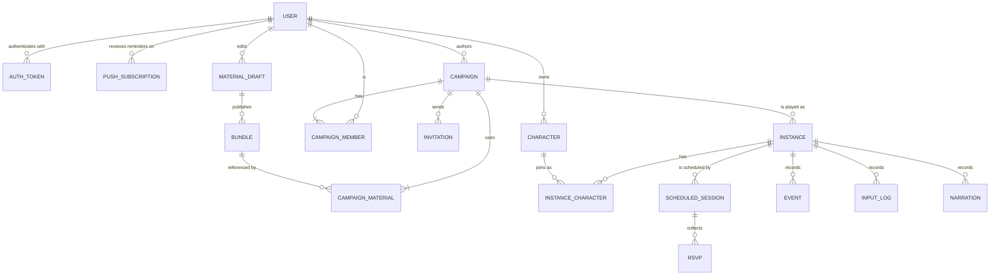

# Data Model

The model is logical. Implementations MAY use relational tables, documents, or both, provided the constraints and atomicity requirements hold. Types: `id` (opaque unique string), `timestamp` (UTC, ISO 8601), `json` (JSON value), `int`, `bool`, `string`.

## Domain overview



| Concept | Contains |
|---|---|
| User | Auth details, characters, active campaigns, authored campaigns |
| Character | A rules system and the attributes that system mandates |
| Campaign | A rules system, players (members), materials, and the instances played from it |
| Campaign instance | One playthrough of a campaign: its player characters, its state, its event history, and its schedule |

A campaign is what an author prepares and invites players to. An instance is what gets played. A campaign MAY have several instances, for example one per group of players or a replay with new characters. Each instance pins the campaign's system version and material versions when it is created, so later campaign edits apply only to new instances.

A user's characters, active campaigns, and authored campaigns are queries over the records below:

| User view | Definition |
|---|---|
| Characters | Character records with `owner_id` = user |
| Active campaigns | Campaigns where the user is a member and has a character in an instance with status `lobby`, `active`, or `paused` |
| Authored campaigns | Campaigns with `author_id` = user |
| Adventures | Material drafts with `owner_id` = user, and bundles with `publisher_id` = user |

## Records

### User

| Field | Type | Constraints |
|---|---|---|
| `id` | id | primary key |
| `email` | string | unique |
| `credential` | string | password hash from a memory-hard function, or an external identity reference |
| `display_name` | string | 1–40 characters |
| `timezone` | string | IANA time zone name, for schedule display; default `UTC` |
| `reminders` | json | `{ "push": bool, "lead_minutes": [int] }`; default `{ "push": true, "lead_minutes": [1440, 15] }`. Each lead time is 5–10,080 minutes. |
| `calendar_token_hash` | string | hash of the secret in the user's calendar feed URL; null when the feed is disabled |
| `operator` | bool | grants administrative operations; default false |
| `status` | string | `active`, `closing`, `deleted` |
| `deletion_requested_at` | timestamp | set when the user requests deletion; null otherwise |
| `terms_accepted_at` | timestamp | when the user accepted the Terms of Service and Privacy Policy |
| `created_at` | timestamp | |

### Auth token

| Field | Type | Constraints |
|---|---|---|
| `token_hash` | string | primary key; hash of the bearer token |
| `user_id` | id | references User |
| `issued_at` | timestamp | |
| `expires_at` | timestamp | |
| `revoked_at` | timestamp | null until revoked |

### Push subscription

A browser that receives Web Push reminders for the user.

| Field | Type | Constraints |
|---|---|---|
| `id` | id | primary key |
| `user_id` | id | references User |
| `endpoint` | string | push service URL issued by the browser; unique |
| `p256dh`, `auth` | string | the subscription's public key and secret, from the browser |
| `label` | string | browser and device description shown in Settings, up to 80 characters |
| `created_at`, `last_used_at` | timestamp | |

A subscription is deleted when the user removes it, when the push service reports it as gone, or when its user is purged.

### Asset

An image, stored once by content hash. Pack art and player-uploaded portraits share this record, its storage, its moderation, its deletion, and its export.

| Field | Type | Constraints |
|---|---|---|
| `hash` | string | primary key; SHA-256 of the file's bytes |
| `kind` | string | `icon`, `portrait`, or `tile` |
| `mime` | string | `image/svg+xml`, `image/png`, or `image/webp`, within the limits in [setting-packs.md](setting-packs.md#art) |
| `bytes`, `width`, `height` | int | measured on upload |
| `alt` | string | 1–200 characters |
| `license`, `credit`, `provenance` | string | as declared; for uploads, entered by the uploader |
| `uploader_id` | id | references User; null for files from packs |
| `bundle_refs` | json | `[{ bundle_id, key }]` of the bundles that declare it |
| `created_at`, `removed_at` | timestamp | `removed_at` is set when an operator removes it after a report |

SVG files are sanitized on upload: scripts, event attributes, external references, and `foreignObject` are removed. Clients display every asset as an image, never inline. An asset no record refers to is erased by the purge job.

### Character

| Field | Type | Constraints |
|---|---|---|
| `id` | id | primary key |
| `owner_id` | id | references User |
| `system` | string | rules system id |
| `system_version` | string | system version that created or last migrated the sheet |
| `name` | string | 1–40 characters |
| `sheet` | json | valid against the system's `character` schema |
| `portrait_asset` | string | optional; hash of an Asset of kind `portrait` uploaded by the owner |
| `status` | string | `available`, `in_instance`, `dead`, `retired` |
| `instance_id` | id | references Instance; set while `in_instance`, otherwise null |
| `created_at` | timestamp | |

A character is in at most one instance at a time. While `in_instance`, the authoritative sheet is the copy in instance state; the Character record's `sheet` is written back when the character leaves the instance or the instance ends.

### Campaign

| Field | Type | Constraints |
|---|---|---|
| `id` | id | primary key |
| `title` | string | 1–80 characters |
| `description` | string | up to 2,000 characters |
| `author_id` | id | references User |
| `system` | string | rules system id; immutable after creation |
| `system_versions` | string | compatible system version range, for example `^1.0` |
| `modules` | string[] | enabled modules of the system; default `[]`. Every material's `system.modules` MUST be a subset. |
| `invite_link_code` | string | unique, revocable; null when link joining is disabled |
| `archived` | bool | archived campaigns accept no new instances, members, or invitations |
| `created_at` | timestamp | |

### Campaign member

| Field | Type | Constraints |
|---|---|---|
| `campaign_id` | id | references Campaign |
| `user_id` | id | references User |
| `role` | string | `author` or `player` |
| `joined_at` | timestamp | |

Primary key: `(campaign_id, user_id)`. Each campaign has exactly one member with role `author`, for `author_id`. The author MAY also play a character.

### Invitation

A single-use invitation code. A member creates it and passes the code or its link to the invitee by any means. Cadmium never stores the invitee's contact details.

| Field | Type | Constraints |
|---|---|---|
| `id` | id | primary key |
| `campaign_id` | id | references Campaign |
| `inviter_id` | id | references User; a member of the campaign |
| `note` | string | up to 80 characters; the inviter's reminder of whom the code is for, shown only to campaign members |
| `invitee_user_id` | id | references User; set when the invitation is accepted |
| `instance_id` | id | optional; the instance the invitation suggests joining |
| `message` | string | up to 500 characters, shown to whoever opens the code |
| `status` | string | `pending`, `accepted`, `declined`, `revoked`, `expired` |
| `token_hash` | string | hash of the invitation code |
| `created_at`, `expires_at`, `responded_at` | timestamp | `expires_at` defaults to 14 days after creation |

An invitation is accepted by a signed-in user presenting its code; acceptance binds it to that user and makes the code unusable. Cadmium has no user directory: no user can look up, search for, or invite another user by name or address. Accepting creates a Campaign Member with role `player`.

### Campaign material

| Field | Type | Constraints |
|---|---|---|
| `campaign_id` | id | references Campaign |
| `kind` | string | `setting` or `adventure` |
| `bundle_id` | string | |
| `bundle_version` | string | version pinned by instances created after this value is set |
| `position` | int | resolution order for settings; lower first |

Each campaign has one adventure and one or more settings. An `author` bundle is usable only in campaigns whose author is the bundle's publisher. Players reach an adventure only by invitation to such a campaign. Every material's declared system range MUST overlap the campaign's `system_versions`, and the adventure's `requires_settings` MUST be satisfied by the campaign's settings.

### Instance

| Field | Type | Constraints |
|---|---|---|
| `id` | id | primary key |
| `campaign_id` | id | references Campaign |
| `name` | string | 1–80 characters, unique within the campaign |
| `system_version` | string | pinned at creation from the installed system; immutable |
| `modules` | string[] | copied from the campaign at creation; immutable |
| `materials` | json | `[{ kind, id, version, position }]`, copied from Campaign Material at creation; immutable after the instance leaves `lobby` |
| `status` | string | `lobby`, `active`, `paused`, `ended` |
| `seed` | int | immutable |
| `rng_algorithm` | string | immutable; `splitmix64_v1` |
| `version` | int | starts at 0; increments on every commit |
| `state` | json | see [Instance state](#instance-state) |
| `ending` | string | ending id, or null |
| `created_at`, `started_at`, `ended_at` | timestamp | null until reached |

### Instance character

| Field | Type | Constraints |
|---|---|---|
| `instance_id` | id | references Instance |
| `character_id` | id | references Character |
| `user_id` | id | references User; the character's owner and a member of the campaign |
| `joined_at` | timestamp | |
| `left_at` | timestamp | null while the character is in the instance |

A character joins only an instance of a campaign whose `system` equals the character's `system`, and whose pinned `system_version` has the same major version as the character's `system_version`.

### Scheduled session

A planned sitting of an instance. Sessions are optional; an instance can be played whenever it is `active`.

| Field | Type | Constraints |
|---|---|---|
| `id` | id | primary key |
| `instance_id` | id | references Instance |
| `title` | string | up to 80 characters |
| `starts_at` | timestamp | first occurrence, UTC |
| `timezone` | string | IANA time zone in which recurrence is computed |
| `duration_minutes` | int | 15–720 |
| `recurrence` | json | null, or `{ "freq": "weekly", "interval": 1–4, "count"?: 1–52, "until"?: timestamp }` |
| `auto_resume` | bool | resume a `paused` instance at each occurrence start; default true |
| `auto_pause` | bool | pause an `active` instance at each occurrence end; default false |
| `notes` | string | up to 500 characters |
| `status` | string | `scheduled` or `cancelled` |
| `created_by` | id | references User |
| `created_at` | timestamp | |

Weekly occurrences keep the same local time in `timezone` across daylight-saving changes. Exactly one of `count` and `until` MAY be set; with neither, a recurring session repeats for 52 occurrences.

### Session exception

| Field | Type | Constraints |
|---|---|---|
| `session_id` | id | references Scheduled Session |
| `occurrence_start` | timestamp | the original start of the affected occurrence |
| `status` | string | `cancelled` or `moved` |
| `moved_to` | timestamp | new start when `moved` |

Primary key: `(session_id, occurrence_start)`.

### RSVP

| Field | Type | Constraints |
|---|---|---|
| `session_id` | id | references Scheduled Session |
| `occurrence_start` | timestamp | original start of the occurrence |
| `user_id` | id | references User; a campaign member |
| `response` | string | `yes`, `no`, `maybe` |
| `updated_at` | timestamp | |

Primary key: `(session_id, occurrence_start, user_id)`.

### Event

| Field | Type | Constraints |
|---|---|---|
| `instance_id` | id | references Instance |
| `seq` | int | starts at 1; contiguous per instance |
| `version` | int | instance version produced by the commit containing this event |
| `actor_id` | id | character id, or null for system and trigger events |
| `type` | string | see [engine.md](engine.md#events) |
| `payload` | json | type-specific |
| `created_at` | timestamp | |

Primary key: `(instance_id, seq)`. Events are append-only.

### Input log

| Field | Type | Constraints |
|---|---|---|
| `id` | id | primary key |
| `instance_id` | id | references Instance |
| `user_id` | id | references User |
| `idempotency_key` | string | unique per user per instance |
| `text` | string | raw input, max 500 characters; null for `submit_action` |
| `parser_context` | json | context sent to the parser |
| `tool_calls` | json | attempted calls, in order |
| `outcome` | string | `committed`, `rejected`, `fallback` |
| `version` | int | instance version after commit, or null |
| `created_at` | timestamp | |

### Narration

| Field | Type | Constraints |
|---|---|---|
| `instance_id` | id | references Instance |
| `version` | int | instance version narrated |
| `text` | string | |
| `source` | string | `model` or `template` |

### Material draft

An editable adventure pack, edited in the adventure editor ([app-flow.md](app-flow.md#adventure-editor)).

| Field | Type | Constraints |
|---|---|---|
| `id` | id | primary key |
| `owner_id` | id | references User |
| `kind` | string | `adventure` |
| `material_id` | string | the adventure id; unique per owner; fixed after the first publication |
| `system` | string | rules system id; fixed after creation |
| `title` | string | 1–80 characters |
| `document` | json | the draft document: adventure manifest, flags, arcs, locations, NPCs, entities, and editor metadata |
| `revision` | int | starts at 1; increments on every save |
| `diagnostics` | json | diagnostics from the last server validation |
| `last_published_version` | string | null until first published |
| `created_at`, `updated_at` | timestamp | |

A save succeeds only when the submitted `revision` equals the stored one. A published adventure id belongs to its first publisher; publishing under an id owned by another user fails with `conflict`.

### Bundle

| Field | Type | Constraints |
|---|---|---|
| `kind` | string | `setting` or `adventure` |
| `id` | string | |
| `version` | string | semantic version |
| `system` | string | rules system id |
| `system_versions` | string | compatible system version range |
| `publisher_id` | id | references User |
| `draft_id` | id | references Material Draft; null for bundles published from files |
| `data` | json | compiled bundle |
| `origin` | string | `operator` for materials installed with Cadmium; `author` for adventures published from drafts |
| `listed` | bool | operator switch for `operator` bundles; when false, listings omit the version |
| `created_at` | timestamp | |

Primary key: `(kind, id, version)`. `data` is immutable. Only `listed` changes after publication.

## Atomicity

A commit writes these items in one atomic operation:

1. All events produced by the resolution.
2. The instance `state`.
3. The instance `version`, incremented by 1.
4. The input log `outcome` and `version`.

When a commit removes a character from the instance or ends the instance, the same operation writes the Character `sheet`, `status`, and `instance_id`, and the Instance Character `left_at`.

## Deletion

Personal data is deleted in three stages, matching the [Privacy Policy](legal/privacy.md#deleting-your-data). Each stage is measured from `deletion_requested_at` for an account and from `deleted_at` for a record.

| Stage | Trigger | Effect |
|---|---|---|
| Recovery | The user deletes their account, or a character, draft, or campaign | Account: `status` becomes `closing` and `deletion_requested_at` is set; the user is signed out and hidden from members. Records: `deleted_at` is set and the record is hidden. Restoring clears the fields. |
| Retention | 30 days after the request | The user cannot restore the records. The records stay hidden from every user. Operators MAY read them only to investigate a report, a dispute, or a request from an authority. |
| Purge | 90 days after the request, run by the scheduled purge job | The records are erased, as below |

Purging an account erases:

- the User row, and the Clerk user through Clerk's API;
- the user's Characters, Material Drafts, published Bundles, RSVPs, Campaign Member rows, Push Subscriptions, Auth Tokens, and Invitations they created or accepted;
- Assets the user uploaded, and Assets referred to only by the user's erased bundles;
- Campaigns the user authored, with their Instances, Events, Input Logs, Narration, and schedules;
- the user's Input Log rows in other users' instances;
- the user's Instance Character rows in other users' instances, after writing `actor_label: "Former player"` into the payloads of that user's remaining Events.

Instances whose pinned materials include a purged Bundle are ended with status `ended` and no ending.

Characters, Material Drafts, Campaigns, and Instances carry a `deleted_at` timestamp for the recovery and retention stages.

At the end-of-course shutdown, sign-in and every operation except operator operations stop, and all records enter retention: hidden from every user, readable by operators only to investigate a report, a dispute, or a request from an authority, or to answer a user's request for their data. 90 days after shutdown, every record is purged, as for an account.

A record preserved for a report of apparently illegal content carries `held_at` and `hold_reason`, set by an operator. The purge job and the shutdown purge skip held records until an operator clears the hold; purging then proceeds as above. Holding a user also holds that user's records listed above. Held records stay hidden from every user while their deletion is pending.


## Instance state

```json
{
  "rng_counter": 0,
  "mode": "exploration",
  "clock": { "turn": 0 },
  "locations": {
    "dock": {
      "rows": ["################", "#....#.........#", "#..............#", "#....#.........#", "#....#.........#", "################"],
      "terrain": { "floor": { "obstructs": [], "cost": 1 }, "wall": { "obstructs": ["movement", "sight"], "cost": 1 } },
      "legend": { ".": "floor", "#": "wall", " ": "void" },
      "rooms": {
        "airlock": { "label": "airlock", "tags": ["entry"], "light": "dim", "area": [[1, 1, 4, 4]], "visited": true },
        "hangar":  { "label": "hangar", "tags": ["large"], "light": "bright", "area": [[5, 2, 1, 1], [6, 1, 9, 4]], "visited": false }
      },
      "links": { "x_lift": { "label": "lift", "at": [14, 2], "to": { "location": "lower_archive", "link": "x_up" } } },
      "seen": ["1111110000000000", "1111110000000000", "1111111111000000", "1111110000000000", "1111110000000000", "1111110000000000"]
    }
  },
  "entities": {
    "e_d1":      { "ref": "base:hatch", "kind": "door", "location": "dock", "at": [5, 2],
                   "open": true, "locked": false, "sheet": { "hp": { "value": 6, "max": 6 }, "status": "active", "structure": true } },
    "lift_door": { "ref": "base:bulkhead", "kind": "door", "location": "dock", "at": [14, 2],
                   "open": false, "locked": true, "lock": { "flag": "lift_powered" } },
    "e_drone1":  { "ref": "base:maintenance_drone", "kind": "creature", "location": "dock", "at": [11, 3],
                   "sheet": { "template": "minion", "hp": { "value": 4, "max": 4 }, "damage": 2, "status": "active" },
                   "conditions": [], "hidden": false }
  },
  "characters": {
    "c_17": { "user_id": "u_3", "location": "dock", "at": [3, 2], "sheet": { }, "conditions": [] }
  },
  "flags": { "alarm_level": 0, "lift_powered": false },
  "character_flags": { "c_17": { "purse": 12 } },
  "stages": { "find_the_core": "searching" },
  "fired_triggers": ["hear_rumor"],
  "revealed": [],
  "round": {
    "number": 4,
    "mode": "exploration",
    "resolution": "simultaneous",
    "participants": ["c_17", "c_22"],
    "declarations": { "c_17": { "tool": "search", "args": {} } },
    "initiative": null,
    "order": null,
    "turn_index": null
  },
  "pending_choices": {},
  "combat_area": [],
  "combatants": [],
  "improvise_streak": { "c_17": 0 },
  "ended": null
}
```

`character_flags` holds character-scoped flags, one map per character, created from each flag's `initial` when the character joins.

Each location holds its compiled map: `rows` with a legend of single terrain ids, the terrain types it uses, rooms with `visited`, links, and `seen`, one string per row with `1` for each cell the party has seen. Entity placements made through a map legend appear in `entities` like any other entity. An entity's room is computed from its anchor cell and is not stored. Light sources carry `light` and `lit`. Cell illumination is computed from rooms and light sources after every action and is not stored.

`sheet` values are owned by the rules system: character sheets follow the system's `character` schema, creature sheets are produced by the system's `instantiate`, and structure sheets by `instantiate_structure`. `conditions` are engine conditions declared by setting packs.

`combat_area` lists the rooms of the combat area and `combatants` the entity ids taking part in combat; both are empty outside combat. See [engine.md](engine.md#modes).

Under `sequential` resolution, `round.order` holds participant ids in resolution order and `round.turn_index` indexes the current participant. Under `simultaneous` resolution, `round.order` is null until the round closes. `round.initiative` holds the last list returned by the system's `initiative` function and persists according to the policy's `reroll`.

`pending_choices` maps a character id to the choice returned by the rules system; see [engine.md](engine.md#pending-choices).

Declarations and pending choices are hidden from other characters' views until they resolve. All references in state use ids; display labels resolve from bundles at read time.
