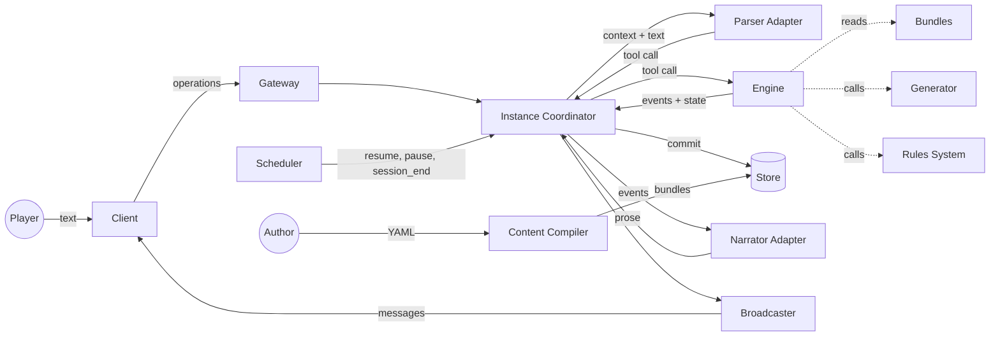
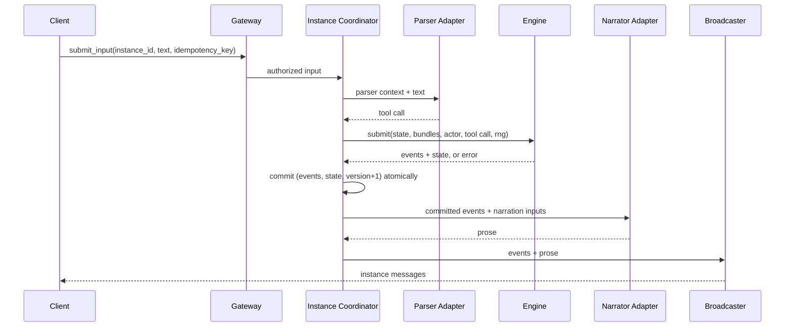

# Architecture

## Context

Players join campaigns and play instances of them in a text dungeon crawler. Each player describes an action in natural language. No human game master is present. The system must interpret free text, apply rules consistently, keep shared state correct under concurrent input, and narrate results, using a model small enough to be inexpensive and fast.

Small models parse intent reliably when choices are narrow and fail when asked to track state or apply rules. The architecture therefore confines models to two translation tasks and assigns every rule decision to deterministic code.

## Goals

- Authoritative, deterministic, replayable game state.
- Rules, settings, and stories defined as data.
- Correct behavior with several players acting at once.
- Bounded model responsibility: one tool call in, prose out.
- Vendor and platform independence.

## Non-goals

- Real-time play. Play proceeds in rounds.
- Continuous space or real-time movement. Space is a square grid per location, resolved one action at a time.
- Model-authored outcomes, rules, or content.

## Context diagram



## Components

Each component has one responsibility. Components communicate only through the interfaces listed here. Deployment topology is unconstrained: all components MAY run in one process or be split across services.

| Component | Responsibility |
|---|---|
| Client | Displays instance output and submits inputs. Holds no authoritative state. |
| Gateway | Authenticates requests, checks group membership, and routes operations. |
| Instance Coordinator | Serializes actions within an instance, runs timers, and commits engine results. |
| Rules System | Decides ruleset-specific outcomes through the contract in [systems/README.md](systems/README.md). Pure and deterministic. |
| Scheduler | Computes session occurrences, sends reminders, and asks the Coordinator to resume, pause, or run `session_end` at occurrence boundaries. |
| Notifier | Delivers session reminders to users on the per-user stream and by Web Push. Cadmium sends no email. |
| Parser Adapter | Builds parser context, invokes the parser model, and returns one tool call. |
| Engine | Validates and resolves a tool call against state. Pure and deterministic. |
| Narrator Adapter | Converts committed events into prose. |
| Generator | Builds location maps from location specs and a seed. Pure and deterministic. |
| Content Compiler | Validates authoring files and emits bundles. |
| Store | Persists records, bundles, state snapshots, and events. |
| Broadcaster | Delivers instance messages to subscribed clients. |

## Trust boundaries

- Player input is untrusted.
- Parser output is untrusted. The engine validates every field of every tool call.
- Narrator output is display text only. No component parses narrator output to change state.
- Models receive only the context defined in [tools.md](tools.md). Secrets, hidden entities, and rule internals MUST NOT appear in model context.

A prompt-injection attack on the parser can, at most, produce a tool call. The engine rejects any tool call the actor is not permitted to make.

## Engine interface

```
submit(state, bundles, actor_id, tool_call, rng) -> Result
advance(state, bundles, rng) -> Result
Result = { ok: true,  events: Event[], state: State }
       | { ok: false, error: { code: ErrorCode, detail: string } }
```

`submit` handles one character action. Depending on the round's resolution method, it resolves the action, stores it as a declaration, or rejects it. When the last outstanding declaration arrives, `submit` also closes and resolves the round.

`advance` ends the current wait: it skips the current participant under `sequential` resolution, or closes the round under `simultaneous` resolution. The Instance Coordinator invokes `advance` when a round timeout expires.

The engine MUST:

- Perform no I/O and read no clock.
- Produce identical output for identical input, including RNG state.
- Return either a complete result or an error. Partial results are not permitted.
- Evaluate adventure triggers after each resolved action and include trigger events in the same result.

## Action pipeline



1. The Gateway authenticates the user and confirms that the user controls a character in the instance.
2. The Instance Coordinator acquires the instance's write slot (see Concurrency).
3. The Parser Adapter builds context from the state and invokes the parser. The parser returns exactly one tool call.
4. The engine resolves the call, stores it as a declaration, or rejects it. See [engine.md](engine.md#rounds).
5. On a validation error, the Parser Adapter re-invokes the parser once with the error code appended to the context. If the second call also fails, the Coordinator substitutes `improvise` with `category: "unclear"`.
6. The Coordinator commits events, the resulting state, and the incremented version in one atomic write.
7. If the commit contains resolved actions, the Narrator Adapter produces prose from the committed events. A commit containing only a declaration is not narrated.
8. The Broadcaster sends the events and prose to every subscriber.

Narration runs after commit. A narrator failure does not roll back state. On narrator failure, the Coordinator emits template text generated from the event types, followed by the commit's facts ([tools.md](tools.md#narrator-context)).

## Concurrency

An instance has exactly one writer at a time. Implementations MUST use one of these strategies:

- **Single-writer queue.** All inputs for an instance pass through one ordered queue processed by one worker.
- **Optimistic versioning.** The commit succeeds only if the stored version equals the version read before resolution. On conflict, the Coordinator reloads state and repeats from step 3.

Every input carries a client-generated `idempotency_key`. The Coordinator MUST NOT apply the same key twice within an instance.

The order in which inputs reach the Coordinator affects only when a declaration is stored. It never affects resolution order, which the engine computes from the ordering policy. See [engine.md](engine.md#rounds).

## Scheduling

The Scheduler expands each scheduled session into occurrences in the session's time zone. At each occurrence boundary it submits an operation to the Instance Coordinator through the serialized write path:

| Moment | Operation |
|---|---|
| Each member's reminder lead times before start (default 24 hours and 15 minutes) | Send `session_reminder` through the Notifier. No state change. |
| Start, when `auto_resume` and the instance is `paused` | `resume_instance` |
| End | Call the rules system's `session_end` for each character and commit the result. |
| End, when `auto_pause` and the instance is `active` | `pause_instance` after the current round closes |

Scheduler operations are idempotent per `(session_id, occurrence_start, moment)`, with reminders also keyed by member and lead time, so a restarted Scheduler does not repeat them.

## Round timeouts

The engine reads no clock, so the Coordinator enforces time limits. When a round starts, or a sequential turn starts, the Coordinator starts a timer. On expiry, it invokes `advance` through the same serialized write path as inputs. Timer durations are deployment configuration:

| Setting | Default |
|---|---|
| `exploration_round_timeout` | 120 s |
| `combat_turn_timeout` | 60 s |

A timeout of 0 disables the timer; the round then waits for all participants or for the owner's `advance_round` operation.

## Determinism and replay

Each instance records a seed and an RNG algorithm identifier. State contains an RNG counter. The engine derives every random value from `(seed, counter)` and increments the counter per value drawn.

Event payloads do not carry enough to rebuild state, so every commit also records the input that produced it, in the same atomic write (see [data-model.md](data-model.md#commit)):

| Input | Engine call |
|---|---|
| `start`: the seed and the joining characters | Instance start; version 1 |
| `call`: actor, tool, and arguments | `submit` |
| `advance` | `advance` |
| `join`: a character | A character joining a paused instance |
| `leave`: a character id | A character leaving the instance |
| `session_end`: the session and occurrence | `session_end` for each character |
| `restore`: `to_version` and reason | The operator's `restore_instance` |

Replay starts the instance again from the `start` commit and re-runs every later input in version order, with the same bundles, rules system version, and RNG algorithm. Each commit's events MUST equal the recorded events, and the final state MUST equal the stored state; replay fails at the first version whose input is rejected or whose events differ. A `restore` commit emits `state_restored` and takes the state replayed up to its `to_version`. Events and state read back from storage are compared with object keys sorted, because storage does not keep key order.

The command-line harness log holds the same records, one JSON line per commit: `{ version, start: { seed, characters }, events }` for version 1, then `{ version, input, events }` with `input` as `{ actor, tool, args }` or `{ advance: true }`.

## Model adapters

Parser and narrator adapters isolate model vendors from the rest of the system. An adapter:

- Accepts the context structures defined in [tools.md](tools.md).
- Translates tool definitions into the vendor's tool-calling format.
- Enforces a timeout. On timeout, the parser adapter returns `improvise` with `category: "unclear"`, and the narrator adapter returns an error that triggers template text.
- Records the raw model request and response in the input log.

## Content lifecycle

1. Authors write setting packs as directories of YAML files, and adventure packs in the adventure editor or as YAML files. Each pack binds to one rules system.
2. The Content Compiler validates them and emits versioned bundles.
3. The Store holds bundles immutably, keyed by `(id, version)`.
4. A campaign references material versions. Each instance pins the rules system version and the material versions at creation. Bundle and campaign updates never affect existing instances.

## Key decisions

| Decision | Alternatives considered | Rationale | Consequence |
|---|---|---|---|
| Models produce one tool call per input; the engine owns all state. | Model-managed state; multi-step agent loops. | Small models misremember state and invent outcomes. Validation of a single structured call is complete and cheap. | Inputs outside the tool set route to `improvise`. Compound inputs resolve one action at a time. |
| Square-grid maps with terrain and placed entities; tools name ids, and the engine computes geometry. | Room graph with abstract zones. | An automated referee needs positions to decide reach, sight, cover, and obstruction the same way every time; abstract zones leave those decisions to judgment no component has. Naming ids keeps prompts short and keeps coordinates away from models. | Materials draw maps. The engine specifies pathfinding and line of sight exactly; rules systems supply speed, reach, and metric. See [ADR-0002](decisions/0002-grid-maps.md). |
| Engine-defined ordering per round. | First-come-first-served resolution. | Arrival order reflects network latency, not play. Engine order is reproducible and fair. | Simultaneous rounds require declarations and a close step; timeouts live in the Coordinator. |
| Event log plus state snapshot, committed atomically. | Pure event sourcing; snapshot only. | Snapshots make reads cheap; events provide history, audit, and replay. | Every commit writes both. Replay verifies that they agree. |
| Relational records for users, characters, campaigns, invitations, instances, and schedules; JSON for state and bundles. | Fully relational game state; document store for everything. | Relationships and permissions suit relational constraints; game state changes shape with content. | State is validated by the engine, not by the database. |
| Content compiled to immutable, versioned bundles pinned per instance. | Live content edits. | Running instances must not change rules mid-play. Compilation catches errors before play. | Publishing a fix requires a version bump; existing sessions keep the old version. |
| Narration after commit, with template fallback. | Narrate before commit. | Narration failure must not lose or block a valid action. | Players can receive events before prose. Clients display both. |
| Rules in swappable system modules behind a contract. | One parameterized rules core; rules scripted in materials. | Established rulesets differ in their core roll, health model, and ordering. Code modules keep rules testable and deterministic. See [ADR-0001](decisions/0001-pluggable-rules-systems.md). | Materials and characters bind to one system. Adding a ruleset is a code release. |
| Campaign separate from campaign instance. | One record holding both setup and play state. | Authors prepare and invite once; groups play, replay, or split into several playthroughs. | State, events, characters, and schedules attach to instances. Campaign edits affect only new instances. |
| Scheduling is advisory with optional automatic resume and pause. | Play only during scheduled slots; no scheduling. | Groups need shared times and reminders, but asynchronous play must keep working. | The Scheduler drives the Coordinator through the same write path as players. |
| Invitation-only play with no social features. | User search, profiles, friends, public adventure listings. | Content stays among people who already know each other, which removes the need for proactive moderation. | Discovery happens outside Cadmium; invitations are by single-use code or campaign invite link; published adventures are usable only in their author's campaigns. |
| No email from Cadmium. Invitations are codes the inviter shares; reminders go to the user stream and Web Push. | A transactional mail provider for invitations and reminders. | Every external service adds an account, a data processor, and a failure mode. Codes need no address book; Web Push needs no vendor account. Sign-in email stays with the identity provider. | Cadmium stores no invitee addresses. A user who never opens Cadmium and never enables Web Push receives no reminders; the calendar feed covers calendar applications that honour alarms. |
